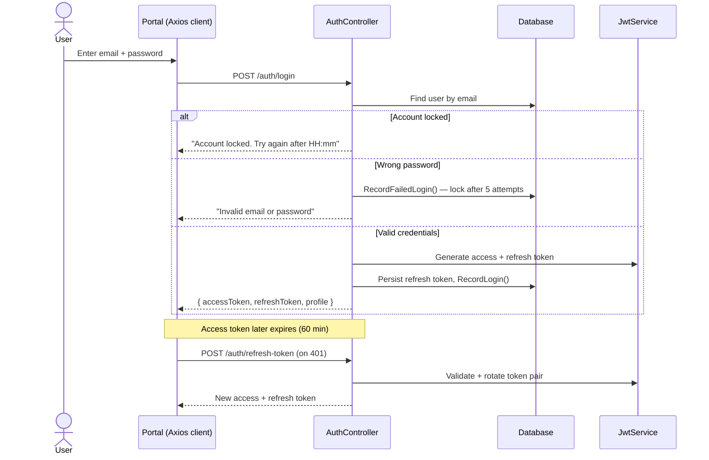

# 01 — Authentication & Accounts

Covers user registration, login, session/token lifecycle, account security, and
self-service profile & address management. Applies to all three portals (customers
sign up in the Customer Store; merchants and admins are provisioned via their
respective flows).

## Flow Diagram

---

## Backend Functionality

### Registration — `POST /api/v1/auth/register`
Creates a new **Customer** account.

- Validates email format (max 256 chars) and password strength via FluentValidation.
- Rejects duplicate emails (case-insensitive; email is stored lower-cased).
- Password is hashed with **BCrypt (cost factor 12)**.
- New users start with `Role = Customer`, `IsEmailVerified = false`, and an
  `EmailVerificationToken` is generated.
- A **welcome email** is dispatched asynchronously (fire-and-forget) after creation.
- Returns an authenticated session (access token + refresh token + user profile),
  so the user is logged in immediately after registering.

### Login — `POST /api/v1/auth/login`
Authenticates an existing user and issues tokens.

- Returns a generic *"Invalid email or password."* message for both unknown emails
  and wrong passwords (avoids account enumeration).
- **Account lockout:** If the account is currently locked, login is refused with the
  unlock time. Each failed attempt increments a counter; after **5 failed attempts**
  the account is locked for **30 minutes**. A successful login resets the counter.
- On success: generates a JWT **access token** and a **refresh token**, persists the
  refresh token on the user, and records the successful login timestamp.

### Token Refresh — `POST /api/v1/auth/refresh-token`
Exchanges a valid, non-expired refresh token for a new access/refresh token pair
(**rotation** — the old refresh token is replaced).

### Logout — `POST /api/v1/auth/logout` *(authenticated)*
Invalidates the current session's refresh token so it can no longer be used.

### JWT & Claims
Access tokens carry: `userId`, `email`, `role`, `firstName`, `lastName`, `jti`.

| Token | Lifetime |
|-------|----------|
| Access token | 60 minutes |
| Refresh token | 30-day rotation |

> Note: `CurrentUserId` on controllers reads the `userId` claim (falling back to `sub`).

### Profile & Account Management — `UsersController` *(authenticated)*

| Endpoint | Purpose |
|----------|---------|
| `GET /api/v1/users/me` | Fetch the current user's profile |
| `PUT /api/v1/users/me` | Update profile (name, phone, avatar, etc.) |
| `POST /api/v1/users/me/change-password` | Change password (verifies current password) |
| `GET /api/v1/users/me/addresses` | List saved addresses |
| `POST /api/v1/users/me/addresses` | Add a new address |
| `DELETE /api/v1/users/me/addresses/{id}` | Remove an address (soft delete) |

Addresses support the standard shipping fields and are reused during checkout.

---

## Frontend Functionality

### Customer Store (`:3000`)
- **`RegisterPage`** — sign-up form; on success the user is authenticated and
  redirected into the store.
- **`LoginPage`** — email/password login; surfaces lockout and invalid-credential
  messages returned by the API.
- **`ProfilePage`** — view/update profile, change password, and manage the saved
  address book used at checkout.
- Auth state (tokens + current user) is held in the Redux **`authSlice`**.

### Merchant Hub (`:3001`) & Admin Panel (`:3002`)
- Each portal has its own **`LoginPage`**; the Merchant Hub additionally has a
  **`RegisterPage`** for seller onboarding (see [Merchant Portal](08-merchant-portal.md)).
- Admin accounts are seeded, not self-registered.

### Session Handling (all portals)
Each portal's `src/api/client.ts` Axios instance:
- Injects the **Bearer access token** on every request.
- On a **401**, automatically calls the refresh-token endpoint and retries the
  original request. Concurrent 401s are **queued** so only one refresh happens,
  then all queued requests replay with the new token.
- If refresh fails, the user is logged out and returned to the login screen.

---

## Security Summary

| Control | Behaviour |
|---------|-----------|
| Password hashing | BCrypt, cost factor 12 |
| Brute-force protection | Lockout after 5 failed logins for 30 minutes |
| Account enumeration | Generic error message for login failures |
| Token rotation | Refresh tokens rotated on every refresh |
| Transport of identity | Stateless JWT with role claims |
| Role-based access | Enforced via `AdminOnly` / `MerchantOrAdmin` / `AnyAuthenticated` policies |

## Related
- [Merchant Portal](08-merchant-portal.md) — seller registration & approval
- [Admin Portal](09-admin-portal.md) — user activation/suspension
- [Notifications](10-notifications-and-realtime.md) — welcome email
