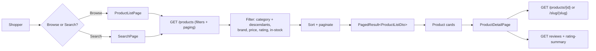

# 02 — Product Catalog & Search

Covers how products are listed, filtered, searched, and viewed, plus the category
taxonomy used for navigation.

## Flow Diagram

---

## Backend Functionality

### Product Listing & Search — `GET /api/v1/products`
Returns a **paginated** list of products filtered by a rich set of query parameters
(`ProductFilterRequest`).

| Filter | Behaviour |
|--------|-----------|
| `Search` | Case-insensitive match across product name, brand (and description) |
| `CategoryId` | Includes the category **and all descendant sub-categories** |
| `Brand` | Exact (case-insensitive) brand match |
| `MinPrice` / `MaxPrice` | Price range bounds |
| `MinRating` | Minimum average rating |
| `InStockOnly` | Restricts to products with available stock |
| `SortBy` / `SortOrder` | Sort by price, rating, newest, etc. (defaults applied) |
| `PageNumber` / `PageSize` | Pagination |

Results are returned as a `PagedResult<ProductListDto>` (items + total count +
paging metadata), returning lightweight cards (id, name, slug, short description,
brand, price, rating, thumbnail).

### Product Detail
| Endpoint | Purpose |
|----------|---------|
| `GET /api/v1/products/{id}` | Full product detail by ID |
| `GET /api/v1/products/slug/{slug}` | Full product detail by SEO slug |

Detail includes description, images, pricing, brand, category, stock/availability,
rating summary, and variant information.

### Product Creation — `POST /api/v1/products` *(MerchantOrAdmin)*
Sellers create products scoped to their own merchant account. See
[Merchant Portal](08-merchant-portal.md) for the full authoring flow, product status
lifecycle (`Draft → Active → OutOfStock → Discontinued`, plus `PendingApproval` /
`Rejected`), and image upload.

### Reviews on Products
Product detail integrates ratings & reviews — see
[Reviews & Ratings](05-reviews-and-ratings.md):
- `GET /api/v1/products/{id}/reviews` — paginated, filterable by star rating
- `GET /api/v1/products/{id}/rating-summary` — aggregate rating breakdown
- `POST /api/v1/products/{id}/reviews` — submit a review *(authenticated)*

### Categories — `CategoriesController`
| Endpoint | Purpose |
|----------|---------|
| `GET /api/v1/categories?rootOnly=true` | List categories (optionally roots only) |
| `GET /api/v1/categories/{id}` | Single category |
| `GET /api/v1/categories/tree` | Full hierarchical category tree |

The taxonomy is **two levels**: 10 root categories (Electronics, Fashion, Home,
Books, Sports, Beauty, Grocery, Toys, Automotive, Health), each with 8 sub-categories.
Category filtering on product search automatically includes descendants.

---

## Frontend Functionality (Customer Store `:3000`)

| Page | Functionality |
|------|---------------|
| **`HomePage`** | Landing page with featured/category entry points |
| **`ProductListPage`** | Browse products with category, price, rating, brand filters, sorting, and pagination |
| **`SearchPage`** | Full-text search results with the same filter/sort controls |
| **`ProductDetailPage`** | Product images, description, price, variants, stock status, "add to cart"/wishlist actions, and the reviews & rating-summary section |
| **`ProductCard`** (component) | Reusable product tile used across listing, search, and home |

- Product data is fetched via TanStack Query hooks wrapping `src/api/products.ts`.
- Filters and pagination are driven from the URL/query state so results are shareable.
- The detail page composes catalog data with reviews (see doc 05) and the cart/wishlist
  actions (docs 03 and 06).

---

## Related
- [Shopping Cart](03-shopping-cart.md) — adding products to cart
- [Reviews & Ratings](05-reviews-and-ratings.md) — product reviews
- [Merchant Portal](08-merchant-portal.md) — product authoring & lifecycle
- [Inventory Management](11-inventory-management.md) — stock & availability
