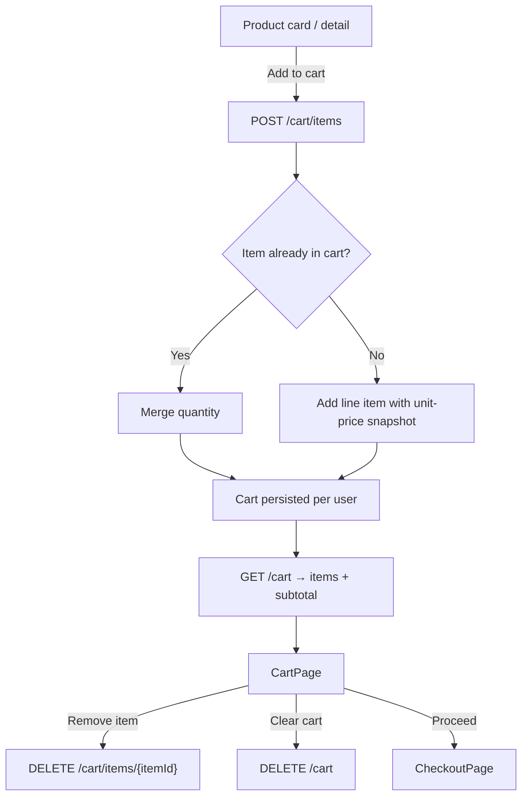

# 03 — Shopping Cart

Covers the customer shopping cart: adding and removing items, quantities, and how
the cart feeds into checkout.

## Flow Diagram

---

## Backend Functionality — `CartController` *(authenticated)*

The entire cart API requires a signed-in user; the cart is keyed to the current user.

| Endpoint | Purpose |
|----------|---------|
| `GET /api/v1/cart` | Retrieve the current user's cart with line items and computed totals |
| `POST /api/v1/cart/items` | Add a product (with quantity and optional variant) to the cart |
| `DELETE /api/v1/cart/items/{itemId}` | Remove a single line item |
| `DELETE /api/v1/cart` | Clear the entire cart |

### Add to Cart
`POST /api/v1/cart/items` accepts `{ productId, quantity, variantId? }`
(`AddToCartCommand`). The handler resolves the product, captures its current unit
price, and merges quantity into any existing matching line item.

### Cart Retrieval
`GET /api/v1/cart` (`GetCartQuery`) returns each line item with product reference,
unit price, quantity, and line total, along with the cart subtotal. This is the data
the checkout flow reads to compute order totals.

### Behavioural Notes
- The cart holds a **snapshot of unit price** per line item at add time.
- Cart persistence is server-side and user-scoped, so the cart follows the user
  across devices/sessions.
- Cart contents are consumed when an order is placed — see
  [Checkout & Orders](04-checkout-and-orders.md).

---

## Frontend Functionality (Customer Store `:3000`)

| Page / Store | Functionality |
|--------------|---------------|
| **`CartPage`** | Lists cart line items, allows quantity changes and item removal, shows the running subtotal, and provides the entry point to checkout |
| **`cartSlice`** (Redux) | Holds client-side cart state for responsive UI updates |
| **`ProductCard` / `ProductDetailPage`** | "Add to cart" actions that call the cart API |
| **`Navbar`** | Cart indicator / item count |

- Cart state is one of only two Redux slices (`authSlice`, `cartSlice`); all other
  server data uses TanStack Query.
- Coupon codes are applied at checkout rather than on the cart itself — see
  [Coupons & Discounts](07-coupons-and-discounts.md).

---

## Related
- [Checkout & Orders](04-checkout-and-orders.md) — converting the cart into an order
- [Coupons & Discounts](07-coupons-and-discounts.md) — applying discounts
- [Product Catalog](02-product-catalog-and-search.md) — where items are added from
