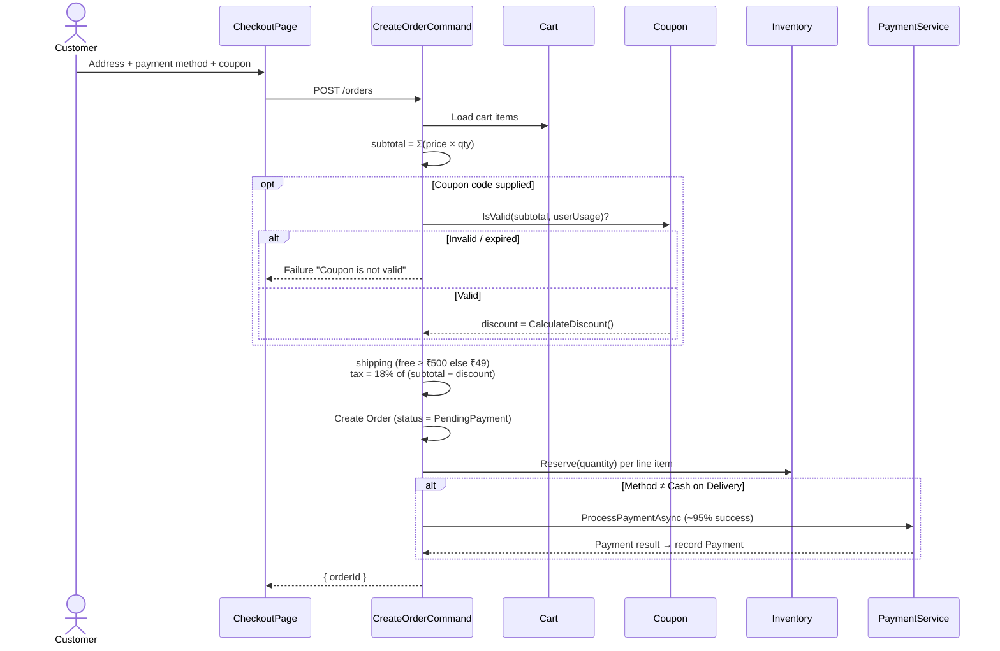
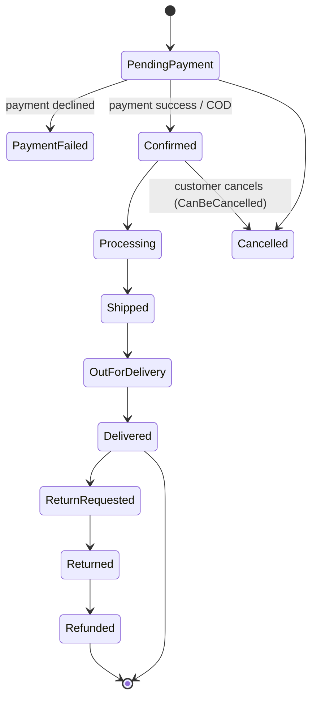

# 04 — Checkout & Orders

Covers order placement (checkout), pricing/tax/shipping calculation, payment
processing, inventory reservation, order status lifecycle, tracking, and cancellation.

## Flow Diagram — Order Placement

---

## Backend Functionality — `OrdersController` *(authenticated)*

| Endpoint | Purpose | Access |
|----------|---------|--------|
| `POST /api/v1/orders` | Place an order from the current cart | Any authenticated |
| `GET /api/v1/orders` | List the current user's orders (paginated) | Any authenticated |
| `GET /api/v1/orders/{id}` | Order detail (role-aware) | Owner / Merchant / Admin |
| `POST /api/v1/orders/{id}/cancel` | Cancel an order | Owner |
| `PATCH /api/v1/orders/{id}/status` | Advance order status | MerchantOrAdmin |
| `GET /api/v1/orders/{id}/tracking` | Fetch tracking/status timeline | Owner |

### Order Placement — `CreateOrderCommand`
When a customer checks out, the handler runs the following flow:

1. **Load the cart** for the current user.
2. **Compute the subtotal** = Σ(unit price × quantity) across line items.
3. **Apply coupon** (if a code is supplied):
   - Looks up an active, non-deleted coupon by code (upper-cased).
   - Checks per-user usage count and validity via `Coupon.IsValid(subtotal, usageCount)`.
   - Rejects the order if the coupon is invalid/expired.
   - Computes `discount` via `Coupon.CalculateDiscount(subtotal)`.
4. **Compute shipping**: **free** when subtotal ≥ ₹500, otherwise a flat **₹49**.
5. **Compute tax**: **18% GST** on the discounted amount → `(subtotal − discount) × 0.18`.
6. **Compute total** = `subtotal − discount + shipping + tax`.
7. **Create the order** in status `PendingPayment`, snapshotting all amounts and the
   coupon reference/code, and create order line items.
8. **Reserve inventory** for each line item (`Inventory.Reserve(quantity)`) — see
   [Inventory Management](11-inventory-management.md).
9. **Record coupon usage** (a `CouponUsage` row) if a coupon was applied.
10. **Process payment** unless the method is Cash-on-Delivery:
    - Calls `IPaymentService.ProcessPaymentAsync(...)` (simulated gateway, ~95%
      success, ~1.5s latency) with amount, currency `INR`, method, and UPI/card token.
    - Records a `Payment` with a generated transaction ID and gateway reference.

The order returns its new ID on success.

### Order Status Lifecycle
Orders move through the `OrderStatus` enum:

- **Customers** can cancel via `POST /{id}/cancel`, guarded by `Order.CanBeCancelled()`
  (only permitted in early, pre-shipment states); `Order.Cancel(reason)` records the
  reason.
- **Merchants/Admins** advance fulfilment status via `PATCH /{id}/status`
  (e.g. Processing → Shipped → Delivered).

### Order Detail & Tracking
- `GET /{id}` is **role-aware**: the owning customer sees their order; merchants/admins
  have broader visibility (the query is passed the caller's role).
- `GET /{id}/tracking` returns the status timeline for the order.

### Payment (Simulation)
`PaymentService` simulates a gateway with a configurable ~95% success rate and ~1.5s
delay. Payment records carry method, status (`Pending → Processing → Completed / Failed
/ Refunded`), and transaction identifiers. In production, swap for Razorpay/Stripe/PayU.

---

## Frontend Functionality

### Customer Store (`:3000`)
| Page | Functionality |
|------|---------------|
| **`CheckoutPage`** | Multi-step checkout: choose/enter **address → payment method → review & confirm**. Applies coupon codes and shows the computed subtotal, discount, shipping, tax (18% GST), and grand total before placing the order |
| **`OrdersPage`** | Paginated list of the customer's past orders with status |
| **`OrderDetailPage`** | Full order detail, line items, amounts, payment info, live status/tracking, and the cancel action (when eligible) |

> **Known integration caveat:** `CheckoutPage.tsx` chains `.data.data` on the result
> of `ordersApi.createOrder()`, which already unwraps and returns `{ orderId }`
> directly. If checkout misbehaves, fix the call site to avoid double-unwrapping.

### Merchant Hub (`:3001`)
- **`OrdersPage` / `OrderDetailPage`** — sellers view orders for their products and
  advance fulfilment status (Processing → Shipped → Delivered). See
  [Merchant Portal](08-merchant-portal.md).

### Admin Panel (`:3002`)
- **`OrdersPage`** — platform-wide order monitoring. See
  [Admin Portal](09-admin-portal.md).

---

## Pricing Rules Summary

| Component | Rule |
|-----------|------|
| Subtotal | Σ(unit price × quantity) |
| Discount | From applied coupon, validated per user |
| Shipping | ₹0 if subtotal ≥ ₹500, else ₹49 |
| Tax | 18% GST on (subtotal − discount) |
| Total | subtotal − discount + shipping + tax |

## Related
- [Shopping Cart](03-shopping-cart.md) — source of order line items
- [Coupons & Discounts](07-coupons-and-discounts.md) — discount validation
- [Inventory Management](11-inventory-management.md) — stock reservation
- [Notifications](10-notifications-and-realtime.md) — order status notifications
