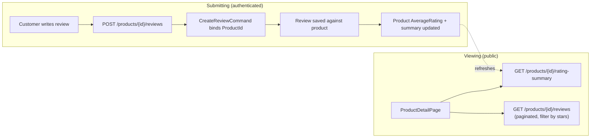

# 05 — Reviews & Ratings

Covers customer product reviews, star ratings, and aggregate rating summaries shown
on product pages.

## Flow Diagram

---

## Backend Functionality

Reviews are exposed through the **Products** API (they are scoped to a product).

| Endpoint | Purpose | Access |
|----------|---------|--------|
| `GET /api/v1/products/{id}/reviews` | Paginated reviews for a product, filterable by star rating | Public |
| `GET /api/v1/products/{id}/rating-summary` | Aggregate rating breakdown for a product | Public |
| `POST /api/v1/products/{id}/reviews` | Submit a review for a product | Authenticated |

### Fetching Reviews — `GetProductReviewsQuery`
Supports pagination (`page`, `pageSize`, default 10) and an optional `rating` filter
so shoppers can view, e.g., only 1-star or 5-star reviews.

### Rating Summary — `GetProductRatingSummaryQuery`
Returns the aggregate rating data (average rating and the distribution across star
buckets) used to render the summary widget on the product detail page. Product
entities also carry an `AverageRating` used for catalog filtering/sorting (see
[Product Catalog](02-product-catalog-and-search.md)).

### Submitting a Review — `CreateReviewCommand`
`POST /api/v1/products/{id}/reviews` binds the route product ID onto the request
(`request with { ProductId = id }`) and records the review against the current user.
The review captures the rating and comment text.

### Data & Governance
- `Review` is a **soft-delete** entity (global query filter on `IsDeleted`), so
  removed reviews disappear from listings without hard deletion.
- The data seeder generates ~600 reviews distributed across products for realistic
  rating summaries.

---

## Frontend Functionality (Customer Store `:3000`)

Reviews are surfaced on the **`ProductDetailPage`**:
- **Rating summary** — average score and star-distribution bars (from the
  rating-summary endpoint).
- **Review list** — paginated reviews with the option to filter by star rating.
- **Write a review** — authenticated customers can submit a rating and comment; the
  new review is reflected on the product.

Review data is fetched with TanStack Query hooks wrapping the products API wrapper.

---

## Related
- [Product Catalog & Search](02-product-catalog-and-search.md) — where reviews are displayed and how `AverageRating` drives filtering
- [Authentication & Accounts](01-authentication-and-accounts.md) — reviewing requires a signed-in user
