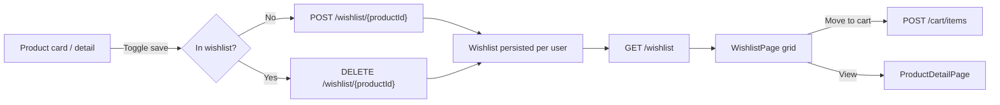

# 06 — Wishlist

Covers saving products for later ("save for later" / favourites) in the Customer Store.

## Flow Diagram

---

## Backend Functionality — `WishlistController` *(authenticated)*

The wishlist is user-scoped; all endpoints require a signed-in user.

| Endpoint | Purpose |
|----------|---------|
| `GET /api/v1/wishlist` | List the current user's saved products |
| `POST /api/v1/wishlist/{productId}` | Add a product to the wishlist |
| `DELETE /api/v1/wishlist/{productId}` | Remove a product from the wishlist |

### Behaviour
- Adding a product already in the wishlist is idempotent (no duplicates).
- The list returns product summary data suitable for rendering cards (so users can go
  straight from wishlist to product detail or add-to-cart).
- Wishlist entries persist server-side per user, so they are available across sessions
  and devices.

---

## Frontend Functionality (Customer Store `:3000`)

| Page / Component | Functionality |
|------------------|---------------|
| **`WishlistPage`** | Grid of saved products with remove and "move to cart"/view actions |
| **`ProductCard` / `ProductDetailPage`** | Wishlist toggle (heart/save action) to add or remove a product |

Wishlist actions call the wishlist API through TanStack Query mutations, and product
cards reflect saved state.

---

## Related
- [Product Catalog & Search](02-product-catalog-and-search.md) — where products are saved from
- [Shopping Cart](03-shopping-cart.md) — moving saved items into the cart
