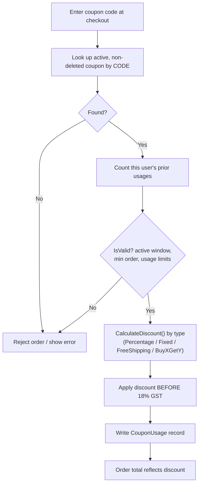

# 07 — Coupons & Discounts

Covers coupon validation, discount calculation during checkout, and administrative
coupon management.

## Flow Diagram

---

## Backend Functionality — `CouponsController`

| Endpoint | Purpose | Access |
|----------|---------|--------|
| `GET /api/v1/coupons/validate/{code}` | Validate a coupon for the current cart/user | Authenticated |
| `GET /api/v1/coupons` | List all coupons | AdminOnly |
| `POST /api/v1/coupons` | Create a coupon | AdminOnly |

### Coupon Types (`CouponType`)
| Type | Meaning |
|------|---------|
| `Percentage` | Percentage off the order (e.g. 10%) |
| `Fixed` | Flat amount off (e.g. ₹200) |
| `FreeShipping` | Waives the shipping fee |
| `BuyXGetY` | Buy-X-get-Y promotion |

### Validation & Discount Rules (domain logic on `Coupon`)
- **`IsValid(orderAmount, userUsageCount)`** — checks the coupon is active, within its
  validity window, meets the **minimum order amount**, and hasn't exceeded per-user /
  global usage limits.
- **`CalculateDiscount(orderAmount)`** — computes the discount for the order based on
  the coupon type and value.

### Where Coupons Apply (Checkout)
During order placement (`CreateOrderCommand`, see
[Checkout & Orders](04-checkout-and-orders.md)):
1. The supplied code is upper-cased and looked up among active, non-deleted coupons.
2. Per-user usage is counted from `CouponUsage` records.
3. If `IsValid(...)` fails, the **order is rejected** with *"Coupon is not valid or
   has expired."*
4. On success, the discount is applied **before tax** (tax is 18% of
   `subtotal − discount`), and a `CouponUsage` record is written to enforce usage limits.

### Seeded Coupons (for testing)
| Code | Type | Value | Min Order |
|------|------|-------|-----------|
| `WELCOME10` | 10% off | 10% | ₹0 |
| `FLAT200` | Fixed | ₹200 off | ₹999 |
| `SUMMER25` | 25% off | 25% | ₹1,499 |
| `FREESHIP` | Free delivery | Free ship | ₹0 |
| `TECH15` | 15% off | 15% | ₹2,000 |
| `FASHION20` | 20% off | 20% | ₹1,000 |

---

## Frontend Functionality

### Customer Store (`:3000`)
- **`CheckoutPage`** — the customer enters a coupon code; the app validates it and, if
  valid, shows the discount line and recomputed totals before the order is placed.
  Invalid/expired codes surface the API error message.

### Admin Panel (`:3002`)
- **`CouponsPage`** — admins list existing coupons and create new ones (code, type,
  value, minimum order, validity, usage limits). See
  [Admin Portal](09-admin-portal.md).

---

## Related
- [Checkout & Orders](04-checkout-and-orders.md) — where discounts are applied
- [Admin Portal](09-admin-portal.md) — coupon management
