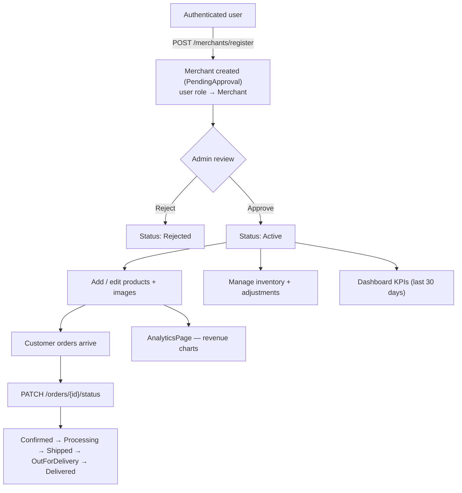

# 08 — Merchant Portal (Seller Hub)

Covers the seller experience: becoming a merchant, the sales dashboard, product
authoring, inventory, order fulfilment, and analytics. Backend endpoints live under
`MerchantsController` and require the **`MerchantOrAdmin`** policy (except registration).

## Flow Diagram



---

## Backend Functionality — `MerchantsController`

| Endpoint | Purpose | Access |
|----------|---------|--------|
| `POST /api/v1/merchants/register` | Apply to become a merchant | Authenticated user |
| `GET /api/v1/merchants/me` | Get the current merchant profile | MerchantOrAdmin |
| `PUT /api/v1/merchants/me` | Update business profile | MerchantOrAdmin |
| `GET /api/v1/merchants/me/dashboard` | Sales dashboard KPIs | MerchantOrAdmin |
| `GET /api/v1/merchants/me/products` | List the merchant's products | MerchantOrAdmin |
| `GET /api/v1/merchants/me/orders` | List orders for the merchant's products | MerchantOrAdmin |
| `GET /api/v1/merchants/me/inventory` | Inventory across the merchant's products | MerchantOrAdmin |
| `POST /api/v1/merchants/me/inventory/{productId}/adjust` | Adjust stock for a product | MerchantOrAdmin |

### Seller Onboarding — `POST /merchants/register`
- Any authenticated user can apply once (rejected if they already have a merchant
  account).
- Captures business details: business name, email, phone, address, city, state,
  pincode, **GSTIN**, **PAN**, and description. Country defaults to *India*.
- The new merchant starts in **`PendingApproval`** status, and the user's role is
  immediately promoted to **Merchant**.
- The application must be **approved by an admin** before the seller becomes active —
  see [Admin Portal](09-admin-portal.md).

### Merchant Status Lifecycle (`MerchantStatus`)
```
PendingApproval → Active → Suspended / Deactivated
             ↘ Rejected
```

### Sales Dashboard — `GET /merchants/me/dashboard`
Aggregates KPIs for the merchant over the last 30 days:
- **Total products** and **active products**
- **Total orders** and **pending orders** (orders in `Confirmed` status awaiting action)
- **30-day revenue** (sum of order totals excluding cancelled orders)
- **Top 5 products** by units sold (with revenue)

### Product Management
- Products are created via `POST /api/v1/products` (`MerchantOrAdmin`), scoped to the
  authenticated merchant. Product status follows `ProductStatus`:
  `Draft → Active → OutOfStock → Discontinued`, plus `PendingApproval` / `Rejected`
  for moderation.
- Product images are stored via `IFileStorageService` (local `uploads/` folder;
  swappable for S3).

### Order Fulfilment
- Merchants see orders containing their products (`GET /merchants/me/orders`).
- They advance fulfilment status through `PATCH /api/v1/orders/{id}/status`
  (`MerchantOrAdmin`): typically **Confirmed → Processing → Shipped → OutForDelivery →
  Delivered**. See [Checkout & Orders](04-checkout-and-orders.md).

### Inventory
- `GET /merchants/me/inventory` lists stock levels; `POST /me/inventory/{productId}/adjust`
  applies a stock adjustment with a reason (recorded against the adjusting user). See
  [Inventory Management](11-inventory-management.md).

---

## Frontend Functionality (Merchant Hub `:3001`)

| Page | Functionality |
|------|---------------|
| **`LoginPage` / `RegisterPage`** | Seller sign-in and merchant application (business details) |
| **`DashboardPage`** | KPI cards (products, orders, revenue) and top-products, driven by the dashboard endpoint |
| **`ProductsPage`** | List/manage the merchant's product catalog |
| **`AddProductPage` / `EditProductPage`** | Create and edit products, including image upload and status |
| **`InventoryPage`** | View stock levels and apply adjustments with reasons |
| **`OrdersPage` / `OrderDetailPage`** | View incoming orders and advance fulfilment status |
| **`AnalyticsPage`** | Sales/revenue charts (Recharts visualisation) |
| **`ProfilePage`** | Maintain the business profile |

- The Merchant Hub uses **named** `apiClient` imports (per the frontend conventions).
- Server data uses TanStack Query; charts are rendered with Recharts.

---

## Related
- [Admin Portal](09-admin-portal.md) — merchant approval/rejection workflow
- [Product Catalog](02-product-catalog-and-search.md) — how products appear to shoppers
- [Inventory Management](11-inventory-management.md) — stock adjustments
- [Checkout & Orders](04-checkout-and-orders.md) — order status transitions
