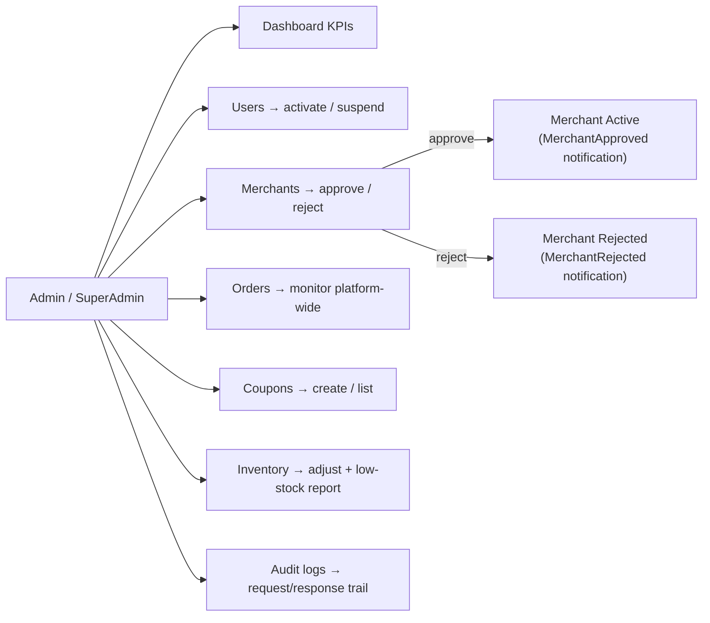

# 09 — Admin Portal (Platform Administration)

Covers platform governance: the analytics dashboard, user management, merchant
approval, product moderation, order monitoring, coupon management, inventory
oversight, and audit logging. All endpoints live under `AdminController` and require
the **`AdminOnly`** policy (Admin + SuperAdmin).

## Flow Diagram

---

## Backend Functionality — `AdminController` *(AdminOnly)*

| Endpoint | Purpose |
|----------|---------|
| `GET /api/v1/admin/dashboard?days=` | Platform-wide KPIs over a period |
| `GET /api/v1/admin/users` | List/search users |
| `PUT /api/v1/admin/users/{id}/toggle-status` | Activate / suspend a user |
| `GET /api/v1/admin/merchants` | List merchants (incl. pending applications) |
| `POST /api/v1/admin/merchants/{id}/approve` | Approve a merchant application |
| `POST /api/v1/admin/merchants/{id}/reject` | Reject a merchant application |
| `GET /api/v1/admin/orders` | Monitor all orders |
| `GET /api/v1/admin/audit-logs` | Browse audit trail |
| `GET /api/v1/admin/inventory` | Inventory across all merchants |
| `POST /api/v1/admin/inventory/{productId}/adjust` | Adjust any product's stock |
| `GET /api/v1/admin/inventory/low-stock` | List products below their low-stock threshold |

### Platform Dashboard — `GET /admin/dashboard`
Returns aggregate platform statistics (`GetDashboardStatsQuery`) over a configurable
window (`days`): totals and trends across users, merchants, orders, revenue, etc.,
for the admin analytics view.

### User Governance
- `GET /admin/users` lists and filters platform users.
- `PUT /admin/users/{id}/toggle-status` activates or suspends an account (a suspended
  user cannot sign in). This complements the automatic lockout in
  [Authentication & Accounts](01-authentication-and-accounts.md).

### Merchant Approval Workflow
- `GET /admin/merchants` surfaces merchants, including those in `PendingApproval`.
- `POST /admin/merchants/{id}/approve` moves a merchant to **Active**, allowing them
  to sell.
- `POST /admin/merchants/{id}/reject` sets **Rejected**.
- Approval/rejection typically triggers a `MerchantApproved` / `MerchantRejected`
  notification (see [Notifications](10-notifications-and-realtime.md)).

### Order Monitoring
- `GET /admin/orders` gives platform-wide visibility into all orders and their
  statuses/payments.

### Inventory Oversight
- Admins can view and adjust inventory for **any** product, and pull a **low-stock**
  report (`inventory/low-stock`). See [Inventory Management](11-inventory-management.md).

### Coupon Management
- Handled by `CouponsController` (`AdminOnly` for list/create) — see
  [Coupons & Discounts](07-coupons-and-discounts.md).

### Audit Logs
- `GET /admin/audit-logs` exposes the audit trail. `AuditLog` records capture
  request/response and action metadata for governance and troubleshooting.

---

## Frontend Functionality (Admin Panel `:3002`)

| Page | Functionality |
|------|---------------|
| **`LoginPage`** | Admin sign-in (admin accounts are seeded, not self-registered) |
| **`DashboardPage`** | Platform KPI dashboard and charts |
| **`UsersPage`** | Search users and activate/suspend accounts |
| **`MerchantsPage`** | Review pending applications; approve/reject merchants |
| **`ProductsPage`** | Product moderation across the catalog |
| **`OrdersPage`** | Platform-wide order monitoring |
| **`CouponsPage`** | Create and manage coupons |
| **`InventoryPage`** | Inventory oversight and low-stock monitoring |
| **`AuditLogsPage`** | Browse the audit trail |

- The Admin Panel uses **named** `apiClient` imports and TanStack Query for server data.

---

## Related
- [Merchant Portal](08-merchant-portal.md) — the seller side of approval
- [Coupons & Discounts](07-coupons-and-discounts.md) — coupon administration
- [Inventory Management](11-inventory-management.md) — stock oversight
- [Authentication & Accounts](01-authentication-and-accounts.md) — user status & roles
