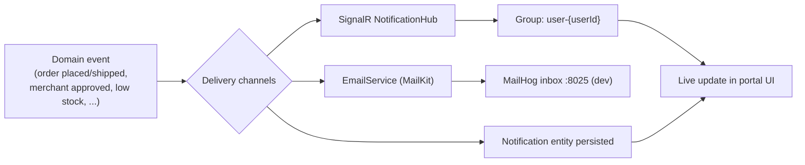

# 10 — Notifications & Real-Time Updates

Covers transactional email, in-app notifications, and real-time (SignalR) delivery of
events such as order status changes.

## Flow Diagram

---

## Backend Functionality

### Notification Types (`NotificationType`)
The platform models a broad set of notifiable events:

| Category | Types |
|----------|-------|
| Orders | `OrderPlaced`, `OrderConfirmed`, `OrderShipped`, `OrderDelivered`, `OrderCancelled` |
| Payments | `PaymentSuccess`, `PaymentFailed`, `RefundInitiated` |
| Merchant | `MerchantApproved`, `MerchantRejected`, `LowStock` |
| Account | `PasswordReset`, `WelcomeEmail` |
| Engagement | `PromotionalOffer`, `ReviewPosted` |

Notifications are persisted via the `Notification` entity for in-app display.

### Email — `IEmailService` / `EmailService`
- Implemented with **MailKit**; on local/dev it targets **MailHog** (inbox at `:8025`).
- Example flow: on **registration**, a **welcome email** is sent asynchronously
  (fire-and-forget) — see [Authentication & Accounts](01-authentication-and-accounts.md).
- Order lifecycle and merchant approval events are the natural triggers for
  transactional emails.

### Real-Time Delivery — SignalR `NotificationHub`
- The hub requires authentication (`[Authorize]`).
- On connect, the user's connection joins a **per-user group** (`user-{userId}`); on
  disconnect it leaves. This lets the server push a notification to a specific user's
  active clients in real time.
- Used to push live updates (e.g. order status transitions, new notifications) to the
  relevant customer/merchant without polling.

---

## Frontend Functionality

### Real-Time Order/Status Updates
- The Customer Store's **`OrderDetailPage`** reflects order status/tracking updates;
  SignalR enables these to update live as merchants advance fulfilment (see
  [Checkout & Orders](04-checkout-and-orders.md)).

### In-App Notifications
- Clients connect to the SignalR hub using the authenticated user's token and listen
  on their per-user channel for pushed events, surfacing them in the UI.

### Email Testing
- During local development, all outbound email is captured by **MailHog** (`:8025`),
  so welcome emails and transactional messages can be inspected without a real SMTP
  provider.

---

## Related
- [Authentication & Accounts](01-authentication-and-accounts.md) — welcome email
- [Checkout & Orders](04-checkout-and-orders.md) — order/payment events
- [Merchant Portal](08-merchant-portal.md) / [Admin Portal](09-admin-portal.md) — merchant approval events, low-stock alerts
