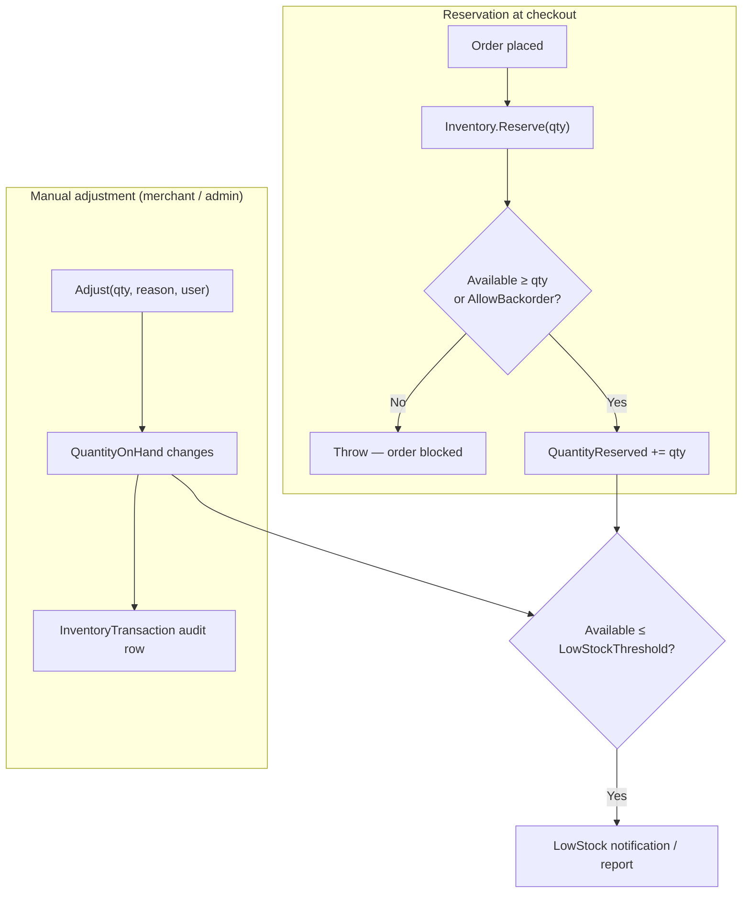

# 11 — Inventory Management

Covers stock tracking, reservation during checkout, manual adjustments with an audit
trail, and low-stock alerting. Inventory is managed by merchants for their own
products and by admins across the platform.

## Flow Diagram

---

## Domain Model — `Inventory`

Each product has an inventory record with the following quantities and settings:

| Field | Meaning |
|-------|---------|
| `QuantityOnHand` | Physical stock in the warehouse |
| `QuantityReserved` | Stock reserved by in-flight orders |
| `QuantityAvailable` | Derived = `OnHand − Reserved` |
| `LowStockThreshold` | At/below this available level the product is "low stock" (default 10) |
| `ReorderPoint` / `ReorderQuantity` | Replenishment hints (defaults 5 / 50) |
| `TrackInventory` | Whether stock is tracked for this product |
| `AllowBackorder` | Whether orders may exceed available stock |
| `WarehouseLocation` / `Barcode` | Fulfilment metadata |

### Business Rules (methods on `Inventory`)
- **`IsLowStock()`** → `QuantityAvailable ≤ LowStockThreshold`
- **`IsOutOfStock()`** → `QuantityAvailable ≤ 0`
- **`Reserve(quantity)`** — increments `QuantityReserved`. If `AllowBackorder` is off
  and available stock is insufficient, it **throws** ("Insufficient stock. Available:
  N"), which blocks the order.
- **`Release(quantity)`** — decrements reservation (floored at 0), e.g. on cancellation.
- **`Adjust(quantity, reason, adjustedBy)`** — changes `QuantityOnHand` and appends an
  **`InventoryTransaction`** capturing the delta, resulting quantity, reason, and who
  performed it — providing a full **audit trail** of stock movements.

---

## Backend Functionality

### Reservation at Checkout
During order placement (`CreateOrderCommand`), each line item calls
`Inventory.Reserve(quantity)`. If stock is insufficient (and backorder is disallowed),
the reservation throws and the order cannot proceed. See
[Checkout & Orders](04-checkout-and-orders.md).

### Merchant Inventory — `MerchantsController` *(MerchantOrAdmin)*
| Endpoint | Purpose |
|----------|---------|
| `GET /api/v1/merchants/me/inventory` | Inventory across the merchant's products |
| `POST /api/v1/merchants/me/inventory/{productId}/adjust` | Adjust a product's stock with a reason |

### Admin Inventory — `AdminController` *(AdminOnly)*
| Endpoint | Purpose |
|----------|---------|
| `GET /api/v1/admin/inventory` | Inventory across all merchants |
| `POST /api/v1/admin/inventory/{productId}/adjust` | Adjust any product's stock |
| `GET /api/v1/admin/inventory/low-stock` | Products at/below their low-stock threshold |

Adjustments made through either portal record an `InventoryTransaction` attributed to
the acting user.

### Low-Stock Alerting
Products crossing the low-stock threshold can raise a `LowStock`
[notification](10-notifications-and-realtime.md); admins can also pull the on-demand
low-stock report.

---

## Frontend Functionality

### Merchant Hub (`:3001`)
- **`InventoryPage`** — lists the merchant's products with on-hand / reserved /
  available quantities and low-stock indicators, and provides a stock **adjustment**
  action (quantity + reason).

### Admin Panel (`:3002`)
- **`InventoryPage`** — platform-wide inventory view with low-stock monitoring and the
  ability to adjust any product's stock.

---

## Related
- [Checkout & Orders](04-checkout-and-orders.md) — reservation on order placement
- [Merchant Portal](08-merchant-portal.md) — seller inventory management
- [Admin Portal](09-admin-portal.md) — platform inventory oversight
- [Notifications](10-notifications-and-realtime.md) — low-stock alerts
