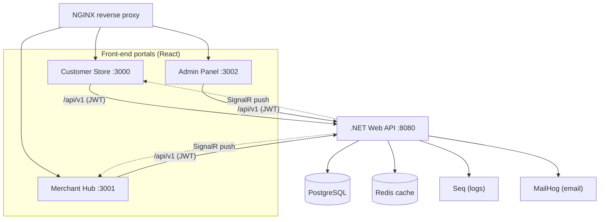

# ShopZone — Functional Documentation

This documentation describes the **functional behaviour** of the ShopZone e-commerce
platform, organised by functional area. Each document covers both the **backend**
(API endpoints, business rules, data flow) and the **frontend** (user-facing screens
and interactions) for that area.

> These documents describe *what the system does* and *how the features behave* for
> end users and integrators. For build/run instructions and architecture internals,
> see [`README.md`](../README.md) and [`CLAUDE.md`](../CLAUDE.md) at the repository root.

## Platform Overview

ShopZone is a full-stack, multi-portal e-commerce ecosystem (similar to Amazon.in)
consisting of three front-end web portals served by a single .NET Web API.



| Portal | Audience | Local URL | Core purpose |
|--------|----------|-----------|--------------|
| **Customer Store** | Shoppers | `:3000` | Browse, cart, checkout, orders, reviews, wishlist |
| **Merchant Hub** | Sellers | `:3001` | Product & inventory management, order fulfilment, sales analytics |
| **Admin Panel** | Platform operators | `:3002` | User/merchant governance, moderation, coupons, audit logs |
| **REST API** | All portals | `:8080` | Single backend for all three portals |

All three portals talk to the same REST API (base path `/api/v1`) and share a common
JSON response envelope, JWT authentication scheme, and role-based authorization model.

## Functional Areas

| # | Document | Summary |
|---|----------|---------|
| 01 | [Authentication & Accounts](01-authentication-and-accounts.md) | Registration, login, JWT/refresh tokens, lockout, profile & addresses |
| 02 | [Product Catalog & Search](02-product-catalog-and-search.md) | Product listing, filtering, search, detail, categories |
| 03 | [Shopping Cart](03-shopping-cart.md) | Add/remove items, quantities, cart persistence |
| 04 | [Checkout & Orders](04-checkout-and-orders.md) | Order placement, payment, totals, tracking, cancellation |
| 05 | [Reviews & Ratings](05-reviews-and-ratings.md) | Writing reviews, rating summaries, moderation |
| 06 | [Wishlist](06-wishlist.md) | Saving products for later |
| 07 | [Coupons & Discounts](07-coupons-and-discounts.md) | Coupon validation, discount calculation, admin coupon management |
| 08 | [Merchant Portal](08-merchant-portal.md) | Seller onboarding, dashboard, products, inventory, fulfilment, analytics |
| 09 | [Admin Portal](09-admin-portal.md) | Dashboard, user/merchant governance, moderation, audit logs |
| 10 | [Notifications & Real-Time Updates](10-notifications-and-realtime.md) | Email, in-app notifications, SignalR live updates |
| 11 | [Inventory Management](11-inventory-management.md) | Stock levels, reservation, adjustments, low-stock alerts |

## Cross-Cutting Conventions

### API Response Envelope
Every API response uses a uniform shape:

```jsonc
// Success
{ "success": true, "data": { /* payload */ } }

// Failure
{ "success": false, "message": "Human-readable error", "errors": ["detail", ...] }
```

### Roles
The platform recognises four roles: **Customer**, **Merchant**, **Admin**, and
**SuperAdmin**. Authorization policies group these:

- `AdminOnly` → Admin + SuperAdmin
- `MerchantOrAdmin` → Merchant + Admin + SuperAdmin
- `AnyAuthenticated` → any signed-in user

### Currency & Regionalisation
All monetary values are in **Indian Rupees (INR)**. Tax is applied at **18% GST**,
free shipping applies to orders **≥ ₹500** (otherwise a flat **₹49** shipping fee).
